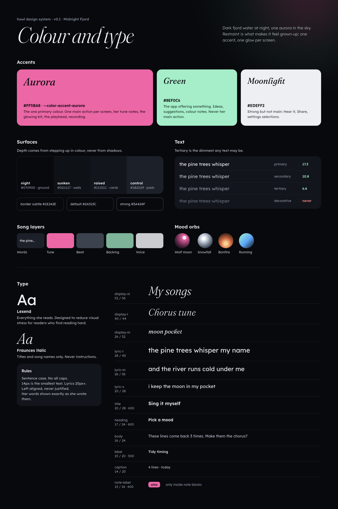
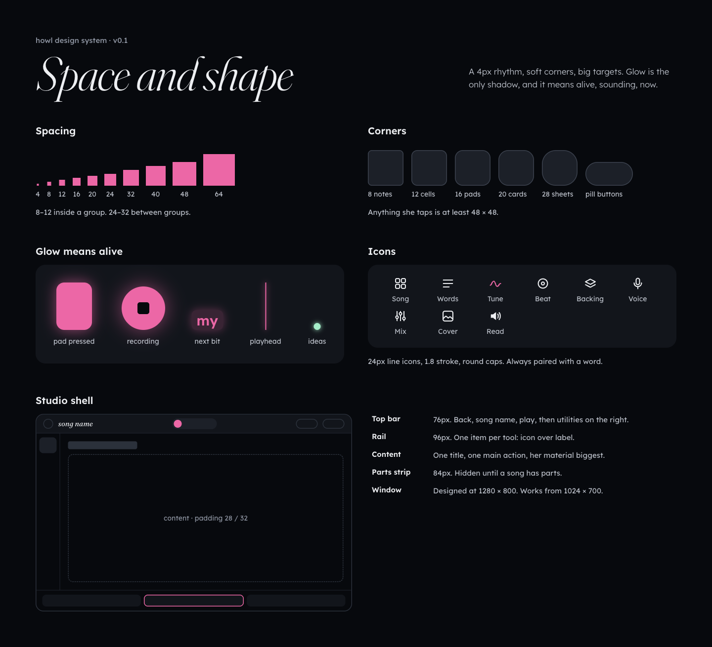
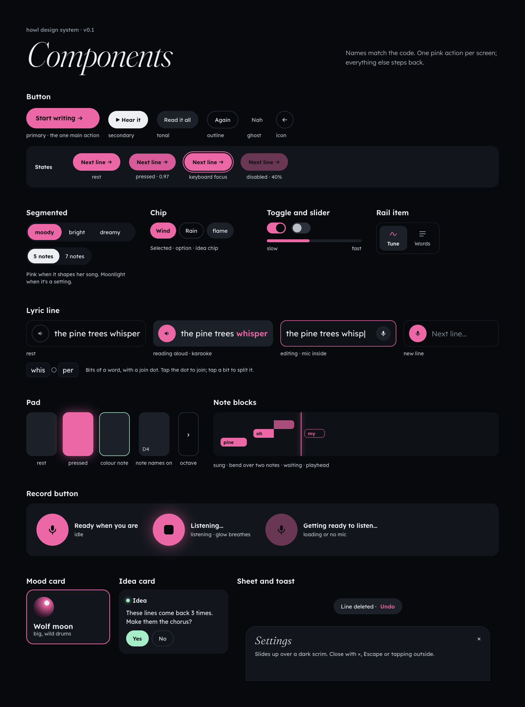
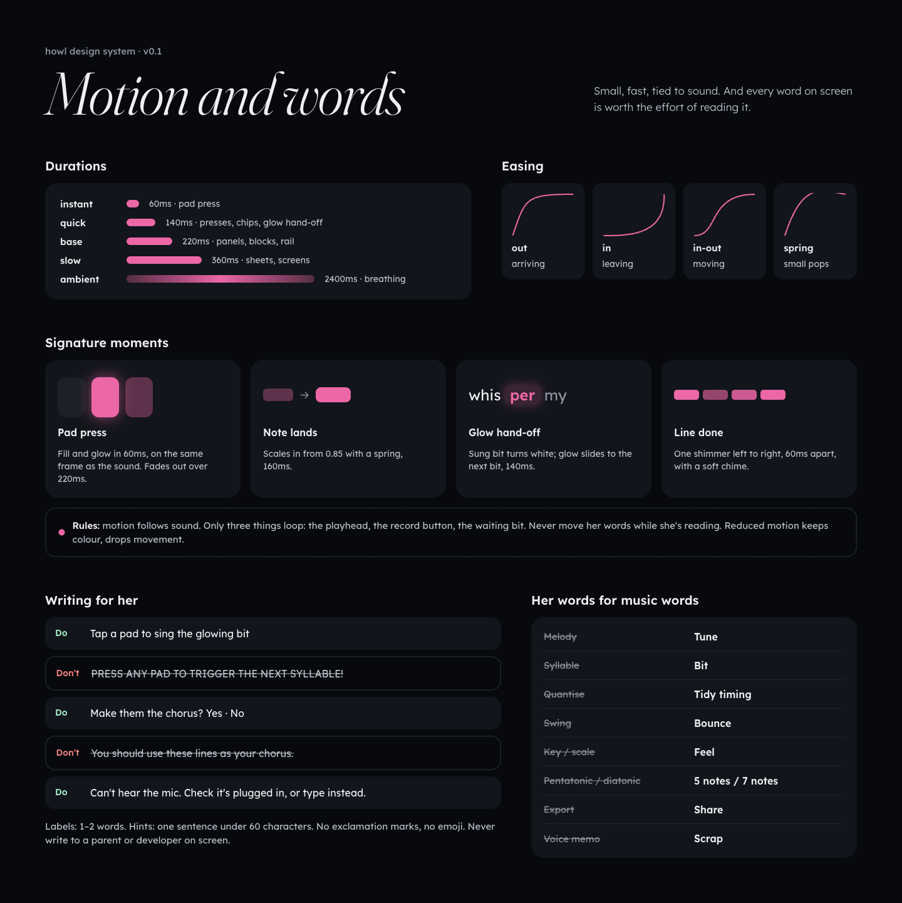

# howl design system

**Theme:** Midnight Fjord · **Version:** 0.1.0 · **Status:** living. It will change as slices ship; change it here first, then rebalance screens.

This document is the contract for how howl looks, moves, sounds and speaks. Any human or AI session building UI for howl must read it first and must use the tokens, not raw values.

- Tokens (source of truth): [`design/tokens.json`](../../design/tokens.json)
- Generated CSS variables + text classes: [`design/tokens.css`](../../design/tokens.css) — regenerate with `node scripts/build-tokens.mjs`
- Paper file (visual reference, same tokens): *Songwriting App — Mood Directions*, pages **Page 1** (mood boards) and **Wireframes** (screens)
- Wireframe exports: [`docs/wireframes/`](../wireframes/)

### See it

The same system as visual boards (Paper page **Design system**; PNG exports here):

| Board | |
| --- | --- |
| Colour and type |  |
| Space, shape, glow, icons, layout |  |
| Components and states |  |
| Motion and writing |  |

If a board and this document disagree, this document and `tokens.json` win; fix the board.

---

## 1. Who it is for, and what that means

howl is a songwriting app for an 11-year-old girl who writes lyrics, has no musical training, and is dyslexic (a good reader, but reading costs her effort). Her influences are artists like Aurora. The app must feel **"cool 13-year-old", not "app for kids"**, and every song must stay **hers**.

Five principles, in priority order. When two conflict, the higher one wins.

1. **Her material is the hero.** Her words, her tune, her art are the biggest, brightest things on screen. Controls recede.
2. **Help is offered, never imposed.** Anything the app suggests is labelled, optional, and only lands when she taps it. The app never writes words or melodies for her.
3. **Every word earns its place.** Reading costs her. Fewer, shorter words; icons always paired with a word; read-aloud everywhere.
4. **Nothing can sound wrong.** Pads, chords and presets are constrained so that whatever she does sounds good. Freedom inside safe walls.
5. **Quiet, dark, one glow.** Restraint is what makes it feel grown-up. One accent colour, one ambient glow per screen.

---

## 2. Colour

Mood: **nocturnal** — dark fjord water at night, one aurora in the sky.

| Token | Hex | Use |
| --- | --- | --- |
| `--color-bg-night` | `#07090D` | App background |
| `--color-surface-sunken` | `#0D1117` | Wells: tune roll, text fields |
| `--color-surface-raised` | `#11151C` | Cards, panels, sheets |
| `--color-surface-control` | `#1B2029` | Resting pads, chips, secondary buttons, selected rail item |
| `--color-border-subtle` | `#1E242E` | Hairlines |
| `--color-border-default` | `#2A313C` | Outlined buttons, dashed empty states |
| `--color-border-strong` | `#3A424F` | Bar lines, stronger outlines |
| `--color-text-primary` | `#EDEFF2` | Her words, headings, labels (17.3:1) |
| `--color-text-secondary` | `#B9BFC9` | Supporting text (10.8:1) |
| `--color-text-tertiary` | `#8B93A1` | Least important text — **the floor for any text** (6.4:1) |
| `--color-text-decorative` | `#5A6270` | **Never text.** Plus signs, drag handles only |
| `--color-accent-aurora` | `#FF5BA8` | **The** primary colour |
| `--color-accent-green` | `#8EF0C6` | Ideas from the app; Backing layer |
| `--color-accent-moonlight` | `#EDEFF2` | Secondary filled buttons; Voice layer |

**Rules**

- **One aurora action per screen.** The pink filled button is the thing to do next. Everything else is control-grey, outlined, or moonlight.
- **Aurora also means "her tune" and "now".** Her note blocks, the glowing next syllable, the playhead, and recording are all aurora. That is deliberate: the tune is hers, so it gets her colour.
- **Green means "the app is offering something".** The Ideas dot, idea cards, the Yes button on a suggestion. Green is never used for a primary action of hers, so she can always tell her stuff from the app's suggestions.
- Text on aurora or moonlight is always `--color-text-on-accent` (`#07090D`).
- Layer colours (Song map): Words = control grey with text, Tune = aurora, Beat = `#3A424F`, Backing = green, Voice = moonlight.
- Mood orbs use the gradients in `color.mood`; they are the only multi-colour elements besides cover art.

---

## 3. Type

Two families, both from Google Fonts (OFL licence) and **bundled locally** in the app (no network fonts).

- **Lexend** — everything she reads. Lexend was designed to reduce visual stress and improve reading speed for people with reading difficulties, and it looks like a normal grown-up typeface.
- **Fraunces** — screen titles and song names only. Always *italic*, weight 300 (400 at 26px). It carries the Aurora-ish, folk-mystic personality. Never used for instructions.

| Class | Font | Size / line | Weight | Use |
| --- | --- | --- | --- | --- |
| `.t-display-xl` | Fraunces italic | 52 / 56 | 300 | Library title |
| `.t-display-l` | Fraunces italic | 40 / 44 | 300 | Screen title in the studio |
| `.t-display-m` | Fraunces italic | 26 / 32 | 400 | Song name in the top bar |
| `.t-lyric-l` | Lexend | 28 / 40 | 400 | The current line on the Tune screen |
| `.t-lyric-m` | Lexend | 26 / 36 | 400 | Lyric lines in Write and Say it all |
| `.t-lyric-s` | Lexend | 20 / 28 | 400 | Lyric lines in lists |
| `.t-title` | Lexend | 20 / 28 | 600 | Card titles, option names |
| `.t-heading` | Lexend | 17 / 24 | 600 | Section labels |
| `.t-body` | Lexend | 16 / 24 | 400 | Descriptions |
| `.t-label` | Lexend | 15 / 20 | 500 | Buttons, chips |
| `.t-caption` | Lexend | 14 / 20 | 400 | Rail labels, timecodes — **minimum size for any text** |
| `.t-note-label` | Lexend | 13 / 16 | 600 | Syllable text inside a note block only |

**Rules**

- Sentence case everywhere. **No ALL CAPS and no tracked uppercase labels** — they are harder for dyslexic readers.
- Left aligned. Never justified. No italic Lexend.
- Lyrics are shown exactly as she wrote or said them (her lowercase stays lowercase).
- A user setting ("Aa") scales lyric styles by 0.9×, 1×, 1.15×, 1.3×. UI chrome does not scale.

---

## 4. Space, size, shape

- **Spacing** is a 4px scale: 4, 8, 12, 16, 20, 24, 32, 40, 48, 64 (`--space-1` … `--space-16`). Tight (8–12) inside a group, generous (24–32) between groups.
- **Radii:** 8 note blocks · 12 cells, inputs, small buttons · 16 pads, list rows · 20 panels, cards · 28 sheets · pill for buttons and chips.
- **Touch:** every tappable thing is at least **48 × 48px**. Chips inside dense panels may be 44px tall. Pads are at least 72 × 120px.
- **Window:** designed at 1280 × 800 (her Windows convertible), must work from 1024 × 700 up to full-screen MacBook. Content max width 1440; beyond that it centres.
- **Elevation:** no drop shadows. Depth = surface steps (night → sunken → raised → control). **Glow is the only shadow, and glow means "alive, sounding, now".**

### Layout shells

**Studio shell** (any screen inside a song)

```
┌──────────────────────────────────────────────────────────────┐
│ Top bar 76px: ← back · song name · [▶ transport] · Undo · Ideas · Share │
├────────┬─────────────────────────────────────────────────────┤
│ Rail   │ Content (padding 28 / 32)                            │
│ 96px   │                                                     │
│ icons  │                                                     │
│ +label │                                                     │
├────────┴─────────────────────────────────────────────────────┤
│ Parts strip 84px (hidden when a song has no parts yet)        │
└──────────────────────────────────────────────────────────────┘
```

**Home shell:** no rail. Logo top-left, utility buttons top-right, a hero title, content below. One aurora glow in a corner.

---

## 5. Iconography

- Line icons, 24px (18px inside buttons), 1.8px stroke, round caps and joins, `currentColor`.
- **An icon is always paired with a word**, except: play/stop in the transport, close (×), and the pad arrows.
- Core set (all drawn in the wireframes): song grid, words (three lines), tune (wave), beat (ring with dot), backing (stacked layers), voice (mic), mix (three sliders), cover (picture), speaker (read aloud), mic (dictate/record), play, stop, plus, undo, share, settings, drag handle.
- Use [Lucide](https://lucide.dev) where an equivalent exists; draw custom only when Lucide lacks one (tune wave, beat ring).

---

## 6. Components

Each component lists anatomy, sizes, states and motion. Names are the names to use in code.

### Button

| Variant | Look | Use |
| --- | --- | --- |
| `primary` | Aurora fill, on-accent text, pill, 48–60px tall | The one main action on a screen ("Start writing", "Save", "Done") |
| `secondary` | Moonlight fill, on-accent text | Strong but not main ("Hear it", "Share") |
| `tonal` | Control-grey fill, primary text | Everyday actions ("Read it all", "Type instead") |
| `outline` | 1.5px `border-default`, primary text | Toggles at rest, "Cancel", options |
| `ghost` | Text only, secondary text | Tertiary ("Nah") |
| `icon` | 48px circle, tonal or outline | Back, speaker, mic |

States: rest → hover (lighten fill 6% or border to `border-strong`, 140ms) → pressed (scale 0.97, 60ms) → disabled (40% opacity, no glow). Focus ring: 2px aurora outline, 3px offset (keyboard only, `:focus-visible`).

### Segmented control

Pill track on `surface-raised`, 4px inset; options 40–44px tall. Selected option: aurora fill (or moonlight when it is a setting rather than her content, e.g. "5 notes / 7 notes"). Selection slides with `--duration-quick` `--ease-inOut`.

### Chip

Pill, 40–44px tall, 14–16px horizontal padding, `.t-label`. Rest: control fill or outline. Selected: aurora fill. Idea chips (rhymes, other words) are control fill; tapping one inserts or replaces a word and the chip pops (scale 1 → 1.06 → 1, spring).

### Rail item

96 × 68px, icon above label (`.t-caption`). Selected: control fill, aurora icon, primary semibold label. Rest: tertiary icon, secondary label.

### Lyric line

Row: speaker button (52px circle) + line text (`.t-lyric-m`). States:
- **rest:** speaker outlined.
- **reading:** row on control fill; speaker aurora filled; the word being spoken is aurora semibold, words already read primary, words to come tertiary (karaoke).
- **editing:** text becomes an inline field on `surface-sunken` with a 1.5px aurora border.
- **new line:** dashed mic button in aurora + placeholder "Next line…" in tertiary.

### Speaker button (read aloud)

Every piece of her text has one. Tap: reads that line with word highlight. Tap again: stop. Uses the voice and speed from Settings.

### Mic / record button

88px aurora circle. Rest: mic icon. Listening/recording: square stop icon, breathing glow (`--glow-record`, opacity 0.6 ↔ 1 over `--duration-ambient`). Always paired with a status label ("Listening…") and a one-line hint.

### Pad (Tune)

Min 72 × 120px, radius 16. Rest: control fill. **Pressed:** aurora fill + `--glow-pad`, on the same frame the note sounds (`--duration-instant`). Released: fades back over 220ms. In 7-note mode, pads whose note is not in the 5-note scale show a 1.5px green inner border at rest so she can find "the colour notes". Arrows at each end shift the pad range one octave (outline, 56px wide).

### Note block (Tune roll)

Aurora fill, radius 8, 24px tall, syllable inside (`.t-note-label`, on-accent). Width = duration. Vertical position = pitch row. **Waiting** (next syllable, not yet sung): dashed aurora outline, aurora text. **Bend** (one syllable, several notes): segments joined with no gap; later segments at 70% opacity. Lands with a 160ms spring scale-in from 0.85 on the frame it is created.

### Playhead

2px aurora vertical line with `--glow-playhead`, moves continuously while playing.

### Glowing syllable

In the big lyric line, the next syllable to sing sits on `--color-accent-aurora-soft` with aurora semibold text and `--glow-syllable`, breathing slowly while waiting. When it is sung it hands off: text turns primary (140ms) and the glow slides to the next syllable (140ms, inOut).

### Panel / card

`surface-raised`, radius 20, padding 20–24. No border unless it is an empty or drop target (then 1.5px dashed `border-default`).

### Ideas panel

A panel with a green dot + "Ideas" heading and a close ×. Content is always one of: chips to try, or one short question with "Yes / No" (or "Try it / Nah"). Never paragraphs. Hidden entirely when Ideas is switched off in Settings.

### Sheet

Slides up from the bottom (`--duration-slow`, `--ease-out`) over a scrim (`--color-bg-scrim` at 70%). Radius 28 at the top corners. Max width 760, centred. Close by ×, Escape, or tapping the scrim. Used for New scrap, Settings, Share.

### Toast

Bottom-centre pill on `surface-control`, one short sentence, auto-hides after 3s. Used for "Saved" and gentle errors.

### Mood card / orb

Card 150px tall; 56px orb (mood gradient) top-left; name (`.t-title`), two-word description (`.t-caption`, secondary). Selected: 2px aurora border. Tapping plays a 4-second preview of the mood.

---

## 7. Motion

Motion is how the app feels alive in the dark. Keep it small, fast, and tied to sound.

| Token | ms | Use |
| --- | --- | --- |
| `--duration-instant` | 60 | Pad press |
| `--duration-quick` | 140 | Presses, chip select, syllable hand-off |
| `--duration-base` | 220 | Panels, block appearing, rail change |
| `--duration-slow` | 360 | Sheets, screen transitions |
| `--duration-ambient` | 2400 | Breathing glows |

Easings: `--ease-out` arriving · `--ease-in` leaving · `--ease-inOut` moving · `--ease-spring` small playful pops (max 6% overshoot).

**Rules**

1. **Motion follows sound.** If it makes a sound, it animates on the same frame the sound starts. Never delay a sound to wait for an animation.
2. **Only three things loop:** the playhead while playing, the record button while recording, the waiting syllable.
3. **Never move her words while she is reading them.** Lines don't reflow, slide or fade while visible except when she acts on them.
4. **Screen changes** cross-fade content (200ms) and keep the shell still. The rail selection slides.
5. **Reduced motion** (`prefers-reduced-motion`): keep colour and opacity changes; drop scale, translate and breathing.

**Signature moments** (worth getting right)

- **Pad press:** aurora fill + glow in 60ms, release fades in 220ms.
- **Note landing:** block scales in from 0.85 with spring, 160ms.
- **Syllable hand-off:** the glow travels to the next syllable, 140ms.
- **Count-in:** four soft pulses on the beat; the waiting syllable pulses with the last one.
- **Line complete:** the line's blocks shimmer left-to-right once (60ms stagger, opacity 1 → 0.6 → 1).
- **Listening:** waveform bars follow the mic level; each new line of text fades up (220ms) as it arrives.

---

## 8. Sound feedback

Sound is part of the interface.

- Every pad press sounds immediately (target under 20ms from touch to sound).
- UI sounds are off by default except: count-in clicks, and a soft "done" chime when a line's tune is complete.
- Nothing ever plays louder than the music. No error buzzers.

---

## 9. Writing for her

She reads well, but it costs her. Every word must be worth it.

- **Talk to her, in second person or as a plain verb.** "Tap a pad to sing the glowing bit." Not "Users can tap…"
- **Labels: 1–2 words.** Instructions: one sentence, under 60 characters, no semicolons.
- **Words a musician uses are swapped for words she uses:** Melody → Tune, Swing → Bounce, Key → Feel, Export → Share, Quantise → Tidy timing, Mute/Solo stay (she knows them from apps). Note and chord names are hidden unless she turns them on.
- **Never write to a parent, developer or designer on screen.** Design notes live in docs, not in the UI.
- **No exclamation marks, no cutesy words, no emoji.** Calm and confident, like a good music app for adults.
- **Suggestions are questions or options**, never statements of what she should do: "Make them the chorus?" with Yes / No.
- **Errors say what to do next**, kindly: "Can't hear the mic. Check it's plugged in." Never blame her.
- Every visible string must work when read aloud by the speaker button.

### Glossary (use these exact words)

| Concept | Word in the app |
| --- | --- |
| Melody | Tune |
| Syllable | bit ("9 bits to sing", "the glowing bit") |
| Quantise | Tidy timing |
| Swing | Bounce |
| Key / scale | Feel (moody, bright, dreamy) |
| Export | Share / Save |
| Project | Song |
| Draft lyric / voice memo | Scrap |
| Verse, chorus… | Parts |
| Pentatonic / diatonic | 5 notes / 7 notes |

---

## 10. Accessibility checklist (every screen)

- [ ] All text ≥ 14px; lyrics ≥ 20px. All text ≥ 4.5:1 contrast (use `text-tertiary` or brighter).
- [ ] No all-caps. Sentence case.
- [ ] Every tappable target ≥ 48px.
- [ ] Every piece of her text has a speaker button; every text field has a mic.
- [ ] Every icon has a word next to it (or an `aria-label` for transport/close/arrows).
- [ ] Everything works with keyboard: Tab order follows reading order; visible focus ring.
- [ ] Nothing depends on hover.
- [ ] Reduced motion respected.

---

## 11. Changing the system

1. Edit `design/tokens.json` (and this file if a rule changes). Bump `$version`.
2. Run `node scripts/build-tokens.mjs`.
3. Update the Paper file's tokens to match.
4. Search the app for any component that hard-codes a value and fix it.
5. Note the change at the bottom of this file.

### Changelog

- **0.1.1** (31 Oct 2026) — added size and opacity tokens for values the slice 1 spec names but tokens lacked.
- **0.1.0** (31 Oct 2026) — first version, extracted from the v2 wireframes.
